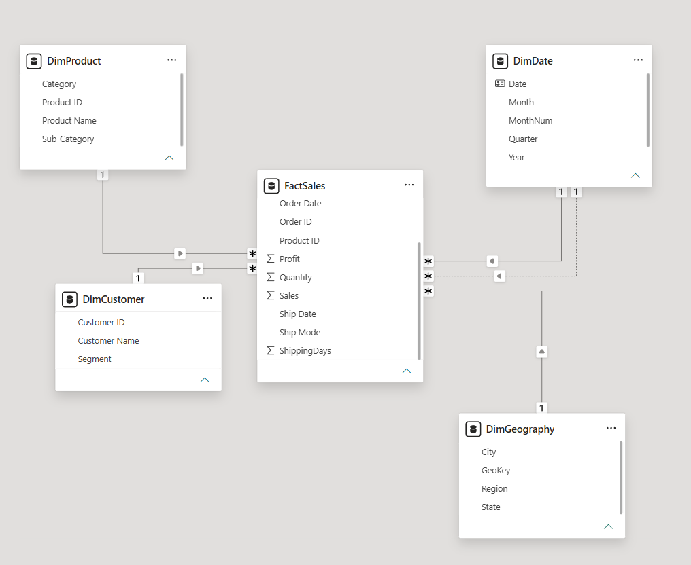
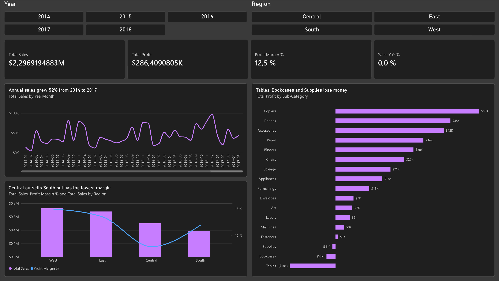
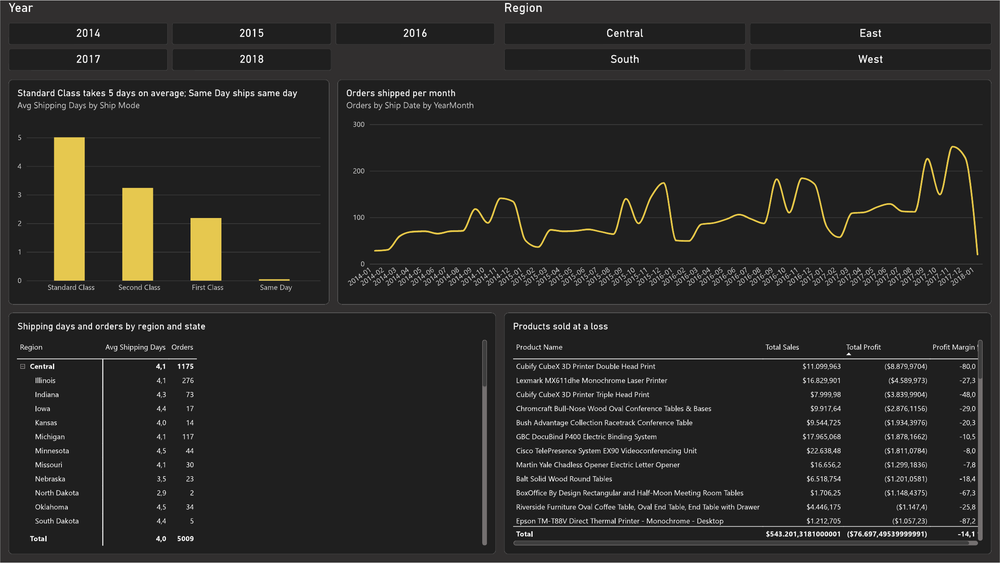

# Retail Sales Dashboard — Power BI

Sales, profitability and shipping-time analysis for a retail chain, built in Power BI Desktop: ETL in Power Query, a star schema, DAX measures, and an executive and an operations dashboard.

## Data

- **Source:** [Superstore Dataset (Vivek Chowdhury, Kaggle)](https://www.kaggle.com/datasets/vivek468/superstore-dataset-final)
- **Original size:** 9,994 rows, 21 columns, a single flat CSV
- **Grain:** one row = one product line within an order

## ETL (Power Query)

All cleaning happens once, in a base query (`Superstore_Raw`). Every other table is built as a *Reference* of it, so any fix propagates to the whole model. The base query itself is not loaded into the model.

### Data types

- The CSV uses US formats (month/day/year dates, period as decimal separator). *Locale for import* was set to *English (United States)* so dates and decimals were not misread under a Colombian regional setting.
- `Order Date` and `Ship Date` set to **Date**: required for the date-table relationship, time intelligence, and shipping-day calculations.
- `Sales`, `Profit` and `Discount` set to **Decimal number**, `Quantity` to **Whole number**.
- `Postal Code` set to **Text**: it is an identifier, not a quantity. 449 rows already carry 4-digit codes in the source CSV (the leading zero was lost upstream). The column is dropped later because the model works at city grain.

### Data quality

| Check | Result | Action |
| --- | --- | --- |
| Duplicates (all columns except `Row ID`) | 1 duplicate record: Row IDs 3406 and 3407, order `US-2014-150119`, the same line recorded twice | One copy removed: 9,994 → 9,993 rows |
| Errors and empty values (*Column quality*, profiled on the entire data set) | 0% errors and 0% empty values in every column | None needed |
| Shipping-date consistency (`ShippingDays` profile) | 0 to 7 days, average 3.96; no negative values (no order ships before it was placed); 519 lines shipped the same day | None needed |

### Transformations

- **Text cleanup:** *Trim* applied to all text columns, so values such as `"Phones "` and `"Phones"` do not split into separate categories or break keys.
- **Dropped columns:** `Country` (a single value, United States, so it adds nothing to filtering), `Row ID` (only needed for the duplicate check) and `Postal Code` (finer than the city grain of the geography dimension).
- **`ShippingDays`:** custom column `Duration.Days([Ship Date] - [Order Date])`, typed as whole number. It is a fixed per-row attribute, so it is computed at the source rather than in DAX.
- **`GeoKey`:** custom column `[City] & "|" & [State]`, the key for the geography dimension (city names repeat across states, and postal codes are not unique per city).

## Data model

Star schema: one fact table (`FactSales`, one row per product line in an order) and four dimensions.

| Table | Key | Rows | Notes |
| --- | --- | --- | --- |
| `FactSales` | — | 9,993 | Order ID, Order Date, Ship Date, Ship Mode, Customer ID, Product ID, GeoKey, Sales, Quantity, Discount, Profit, ShippingDays |
| `DimCustomer` | Customer ID | 793 | Customer Name, Segment |
| `DimProduct` | Product ID | 1,862 | Product Name, Category, Sub-Category |
| `DimGeography` | GeoKey | 604 | City, State, Region |
| `DimDate` | Date | 1,826 | Jan 1, 2014 – Dec 31, 2018; Year, MonthNum, Month, Quarter, YearMonth; full calendar years, created in DAX and marked as the date table |

### Modeling decisions

- **Unique dimension keys:** every key was checked with *Column distribution* (distinct = unique = rows) before relating it.
- **Product ID with more than one name:** 32 `Product ID` values appear with two different product names in the source (e.g. `FUR-BO-10002213`). Deduplicating on ID and name together returns 1,894 rows with a repeated key, which breaks the one-to-many relationship. `DimProduct` was therefore deduplicated on `Product ID` only (1,862 rows), keeping the first name.
- **One product name under several IDs:** after deduplication, `DimProduct` has 1,862 unique `Product ID` values but only 1,818 distinct product names, of which 1,802 appear once. The other 16 names are shared by 60 IDs. This does not affect the relationships (the key is the ID), but a visual grouped by *Product Name* would merge those products, so product-level analysis uses `Product ID`.
- **Composite geography key:** `DimGeography` has 604 city–state combinations but only 531 distinct city names, and just 474 of them belong to a single state. The other 57 names repeat across states (Springfield and Columbia are the most repeated). Keyed on city alone, their sales would merge across states, so the key is `GeoKey` = City | State (604 distinct, 604 unique). Postal code is left out of the model: it is finer than the city grain.
- **`Order ID` and `Ship Mode`** stay in the fact table as degenerate dimensions: few values and no attributes of their own.
- **Relationships:** all one-to-many, single cross-filter direction, from each dimension to `FactSales`.
- **Two dates:** `DimDate[Date]` → `FactSales[Order Date]` is active; `DimDate[Date]` → `FactSales[Ship Date]` is inactive and used through `USERELATIONSHIP` in the shipping measures.
- **`DimDate` range:** from January 1 of the first order year to December 31 of the last ship year, so orders shipped in the following January still have a date. Built-in *Auto date/time* is turned off.



## DAX measures

Stored in a dedicated `_Measures` table.

| Measure | Definition | Why |
| --- | --- | --- |
| Total Sales | `SUM(FactSales[Sales])` | Base measure |
| Total Profit | `SUM(FactSales[Profit])` | Named so it does not clash with the `Profit` column |
| Profit Margin % | `DIVIDE([Total Profit], [Total Sales])` | Ratio of totals, not an average of row margins |
| Orders | `DISTINCTCOUNT(FactSales[Order ID])` | An order spans several rows |
| Avg Order Value | `DIVIDE([Total Sales], [Orders])` | |
| Sales PY | `CALCULATE([Total Sales], SAMEPERIODLASTYEAR(DimDate[Date]))` | Time intelligence on the date table |
| Sales YoY % | `DIVIDE([Total Sales] - [Sales PY], [Sales PY])` | `DIVIDE` returns blank for the first year instead of an error |
| Avg Shipping Days | `AVERAGE(FactSales[ShippingDays])` | |
| Orders by Ship Date | `CALCULATE([Orders], USERELATIONSHIP(DimDate[Date], FactSales[Ship Date]))` | Activates the inactive ship-date relationship |

Validation: every measure was checked in DAX query view against totals computed directly from the source CSV (after removing the duplicate row) and matched exactly: Total Sales 2,296,919.49 · Total Profit 286,409.08 · Profit Margin 12.47% · Orders 5,009 · Avg Order Value 458.56 · Avg Shipping Days 3.96.

## Dashboard

Two report pages on a 1920 × 1080 canvas. Visual titles state the finding, not just the topic.

**Executive Summary** — for a manager: *how are we doing, and where do we make or lose money?*
Year and region slicers; KPI cards (Total Sales, Total Profit, Profit Margin %, Sales YoY %); monthly sales trend; sales and margin by region; profit by sub-category with losses highlighted.

**Operations** — for logistics: *how fast do we ship, and where are the delays?*
Year and region slicers; average shipping days by ship mode; orders by ship date per month (inactive relationship via `USERELATIONSHIP`); region → state matrix with drill-down; products sold at a loss.





### Key findings

- **Growth:** sales grew 52% from 2014 to 2017 ($484K → $733K). After a 2.8% dip in 2015, sales rose 29.5% in 2016 and 20.4% in 2017.
- **Loss-making sub-categories:** Tables (−$17.7K), Bookcases (−$3.5K) and Supplies (−$1.2K) are the only sub-categories with negative profit.
- **Regional margin:** West leads in both sales ($725K) and margin (14.9%). Central ranks third in sales ($501K) but has the lowest margin (7.9%), below South (11.9%).
- **Shipping:** Standard Class averages 5.0 days, Second Class 3.2, First Class 2.2 and Same Day 0.04, so each tier delivers what it promises.
- **Products sold at a loss:** products with a negative margin add up to −$76.7K in profit, against $286.4K of total profit.
- **Cross-year shipping:** 20 orders placed in late December 2017 shipped in January 2018, which is why the date table extends to 2018 and shipping metrics use the ship-date relationship.

## Repository structure

```
powerbi-superstore/
├── superstore.pbip              # open this file in Power BI Desktop
├── superstore.Report/           # report definition (PBIR): pages and visuals as JSON
├── superstore.SemanticModel/    # semantic model (TMDL): tables, Power Query, relationships, DAX measures
├── data/Sample - Superstore.csv # source data
└── img/                         # screenshots used in this README
```

The project is saved in **Power BI Project (.pbip)** format instead of a single `.pbix`, so every query, measure and visual is a text file and changes can be reviewed in Git.

## How to open

1. Clone the repository and open `superstore.pbip` in Power BI Desktop.
2. In Power Query, update the `Source` step of `Superstore_Raw` so it points to `data/Sample - Superstore.csv` in your clone (Power Query stores an absolute path).
3. *Home* → *Refresh*.

## Tools

Power BI Desktop · Power Query (M) · DAX
